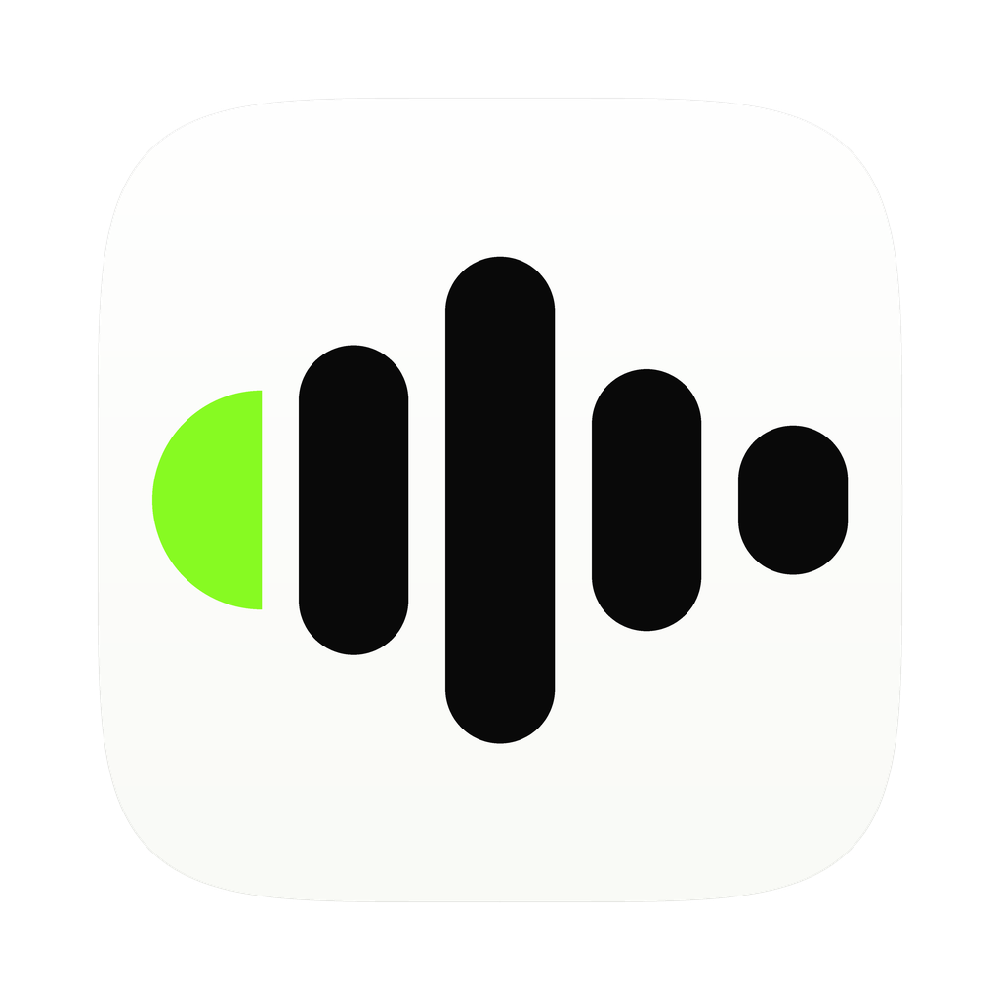
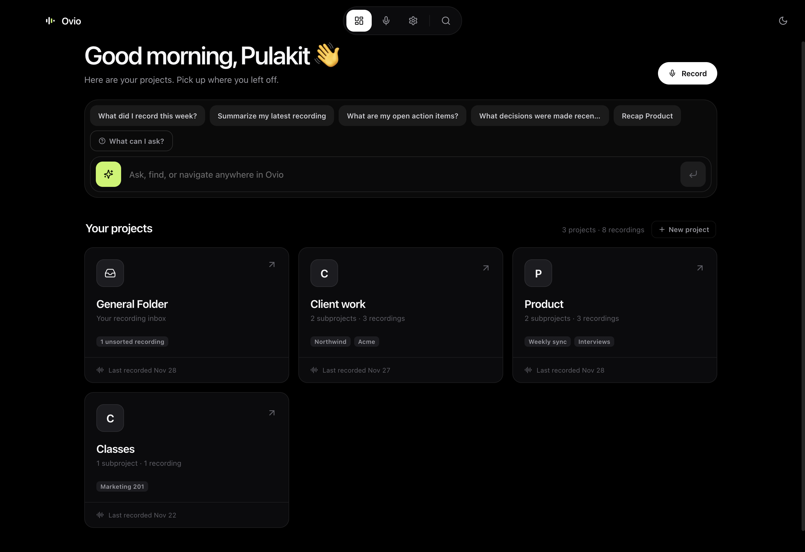
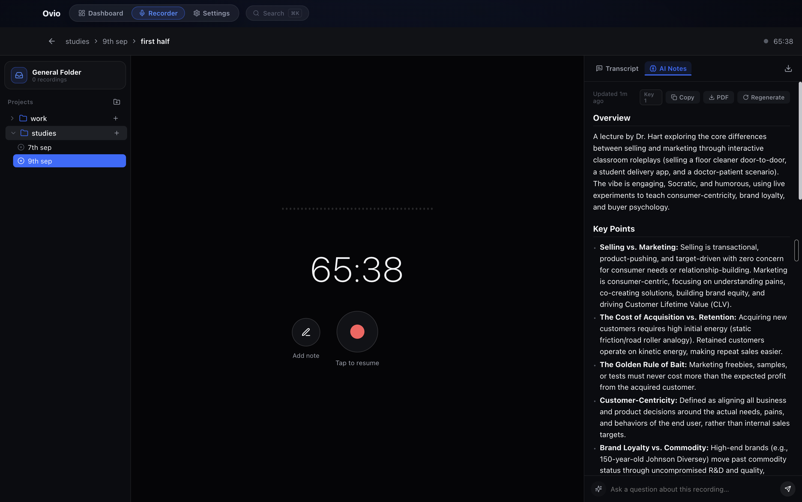
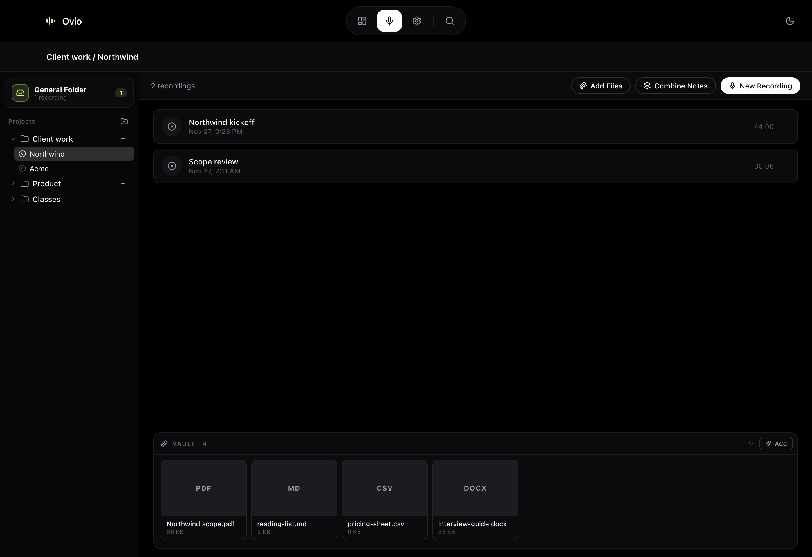

<div align="center">



# Ovio

**Records your meetings, transcribes them, writes the notes.**

On your own laptop. No account, no cloud.

[](https://github.com/pulakit001/ovio/releases/latest)
[](https://github.com/pulakit001/ovio/releases)
[](LICENSE)

macOS · Windows · Linux

</div>



## Why Ovio

Most note taking apps send your audio to someone else's server. Ovio doesn't. Speech to text and the AI that writes your notes both run on your computer, so a private conversation stays private.

It listens through your microphone, which makes it good for in-person meetings, classes, interviews and voice notes. It does not record calls from Zoom or Meet.

## What makes it different

- **It runs on your laptop.** Transcription and notes happen on your machine, not on a server.
- **No account.** Download it and use it.
- **Free and open source.** Read the code, change it, run it yourself.
- **Works offline.** Once the models are downloaded you can turn off wifi.
- **Ask your old meetings anything.** Type "what did we decide about pricing?" and Ovio answers from your recordings and shows which ones it used.
- **Files live next to your recordings.** Every folder has a vault for the PDFs, docs and images that go with that meeting.



## Install

Grab the latest build from [Releases](https://github.com/pulakit001/ovio/releases/latest).

### macOS 13 or newer

```bash
brew tap pulakit001/ovio https://github.com/pulakit001/ovio
brew install --cask ovio
```

Update with `brew upgrade --cask ovio`, remove with `brew uninstall --cask ovio`.

Or take the DMG: `Ovio-mac-arm64.dmg` for Apple Silicon, `Ovio-mac-x64.dmg` for Intel. Open it and drag Ovio into Applications.

Mac builds are not notarized yet, so macOS may say it cannot verify Ovio. If that happens, open System Settings, go to Privacy & Security, then Open Anyway. Homebrew handles this for you.

### Windows

Download `Ovio-Setup.exe` and run it. SmartScreen will warn that the installer is not code signed yet. Click **More info**, then **Run anyway**.

### Linux

```bash
# Debian and Ubuntu
curl -fLO https://github.com/pulakit001/ovio/releases/latest/download/Ovio-amd64.deb
sudo apt install ./Ovio-amd64.deb

# Any other distro (needs libfuse2)
curl -fLO https://github.com/pulakit001/ovio/releases/latest/download/Ovio-x86_64.AppImage
chmod +x Ovio-x86_64.AppImage
./Ovio-x86_64.AppImage
```

## First run

Ovio downloads its models once. Press the single setup button and it fetches the speech engine and the speech model together.

- You need **Python 3.10 to 3.13**. Ovio builds a private environment from it. On a Mac: `brew install python@3.12`.
- The speech engine is about 2 to 3 GB, the speech model about 2.5 GB.
- Then pick a notes model below.

It is a big first download, and you only do it once.

## Use it

1. Click the mic icon in the top bar to open the **Recorder**.
2. Pick a folder, or create a project. You can also create one from the home screen.
3. Press record. Your words appear live in the **Transcript** tab.
4. Open **AI Notes** to read the notes, and hit Regenerate for a new pass.
5. Press stop. It saves on its own.

Notes export as a PDF, transcripts as text.

The top pill has the four places you need: **Dashboard** for stats, projects and questions across your library, **Recorder** for folders and live capture, **Settings** for theme, models and export, and **Search** for titles, transcripts, notes, projects and vault files. Search is Cmd+K on Mac and Ctrl+K on Windows and Linux.

Recordings live in projects, and projects hold folders. The General Folder is the inbox for quick takes.



## Privacy

- Audio and transcripts are handled by a program on your own computer. They are never uploaded.
- Recordings, notes and files stay in the app's data folder.
- There is no account and no tracking.

Ovio makes only three kinds of network request:

| What | When |
|---|---|
| Downloading speech and notes models from Hugging Face | Once, when you choose to download them |
| Checking GitHub for updates | While the app runs |
| Sending your transcript to OpenRouter | Only if you pick cloud notes and add your own key |

Use a local notes model and skip the OpenRouter key if you want nothing to leave your laptop.

## The models

Both models run inside the app. No Ollama, no extra setup.

**Speech: NVIDIA Parakeet TDT 0.6B v3** (about 2.5 GB). It writes your transcript live while you talk.

**Notes: Qwen 2.5.** Pick a size in Settings:

| Model | Size | Good for |
|---|---|---|
| Qwen 2.5 1.5B | about 1.1 GB | Fastest. Older or low memory laptops |
| Qwen 2.5 3B | about 2.0 GB | The one to start with |
| Qwen 2.5 7B | about 4.7 GB | Most detail, for long meetings on a capable laptop |

Want a stronger cloud model? Paste an [OpenRouter](https://openrouter.ai) key in Settings and switch the provider to cloud. Only the transcript text leaves your laptop, never the audio.

## Build it yourself

Node.js 20 or newer.

```bash
git clone https://github.com/pulakit001/ovio.git
cd ovio
npm ci
npm run electron:dev      # run the app
npm run electron:build    # build the installers
```

## License

MIT, copyright Snippetz Labs. See [LICENSE](LICENSE).

If Ovio saves you a meeting, a star helps other people find it.
